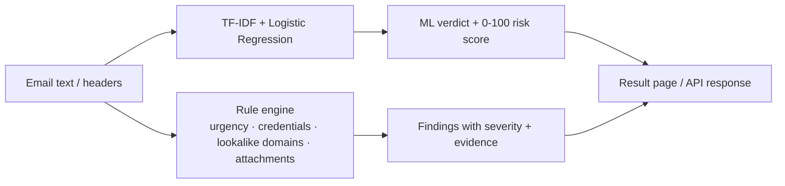

<div align="center">

# 🛡️ PhishNet AI

**Paste a suspicious email → get an ML verdict *and* a transparent rule-based analysis.**

[](https://github.com/durvesh55/Phishnet-AI/actions/workflows/ci.yml)


[Quick start](#-quick-start) · [How it works](#-how-it-works) · [API](#-api) · [Docs](#-documentation) · [Contributing](CONTRIBUTING.md)

</div>

---

## 🔍 How it works



The two analyses are **independent**: rules never change the ML score, and submitted links are **never visited**.

<details>
<summary><b>🧪 Try the API in one command</b></summary>

```bash
curl -H "X-API-Key: pnk_..." -H "Content-Type: application/json"   -d '{"email_text":"URGENT verify your password at http://paypa1.com"}'   http://127.0.0.1:5000/api/v1/scans
```
Swagger UI lives at `/api/docs` when the app is running.
</details>

<details>
<summary><b>📸 Screenshots</b></summary>

Add images to `docs/screenshots/` (`login.png`, `dashboard.png`, `scan-result.png`, `api-keys.png`) and they will show here:

| Dashboard | Scan result |
|---|---|
|  |  |
</details>

---

AI-assisted phishing email analysis. Paste a suspicious email and get **two independent results**:

* **Machine Learning Analysis** – TF-IDF + Logistic Regression → `SAFE` / `SUSPICIOUS` / `PHISHING` and a 0-100 risk score.
* **Security Rule Analysis** – transparent heuristics (urgency, credential requests, lookalike domains, risky attachments…) with severity and evidence.

The rule engine never changes the ML score, and submitted links are **never visited**.

## ✨ Features
Registration + email verification · email OTP 2FA + recovery codes · password reset · login throttling/lockout · scan history (search, filter, sort, pagination, delete) · feedback (stored separately, never auto-trained) · dashboard (all numbers from MySQL) · API keys (hashed, scoped, expiring, rotatable) · versioned REST API `/api/v1` with OpenAPI/Swagger at `/api/docs` · PDF/CSV reports · data export & account deletion · retention settings · audit log · health/readiness endpoints.

## 🧰 Stack
Python 3.12, Flask (app factory + blueprints), SQLAlchemy + Flask-Migrate, **MySQL 8** (PyMySQL), scikit-learn, Redis (rate-limit storage), Gunicorn, Docker Compose, pytest, GitHub Actions. Frontend: Jinja2 + vanilla CSS/JS (no frameworks, strict CSP).

## 🖼️ Screenshots
_Placeholders – add real screenshots to `docs/screenshots/` once you have run the app:_ `login`, `dashboard`, `scan-result`, `api-keys`.

## 🚀 Quick start (local, no Docker)
```bash
python -m venv .venv && source .venv/bin/activate        # Windows: .venv\Scripts\activate
pip install -r requirements-dev.txt
cp .env.example .env                                      # then edit (see below)
```
**MySQL:** edit the password in `scripts/mysql_setup.sql`, then
`mysql -u root -p < scripts/mysql_setup.sql` (creates `phishnet`, `phishnet_test` and a limited user). Put the same user/password in `.env`.
```bash
flask --app run db upgrade        # create tables
python -m ml.training.train       # train + activate a model (ml/models/)
flask --app run record-model      # optional: register model version in DB
python run.py                     # http://127.0.0.1:5000
```
In development `MAIL_BACKEND=console` prints verification/OTP emails to the server log so you can finish flows without SMTP. For real email set `MAIL_BACKEND=smtp` and the `MAIL_*` variables.

## ✅ Tests
```bash
pytest -q          # needs the MySQL test DB (TEST_MYSQL_DATABASE); DB tests are skipped if it is unreachable
ruff check app ml tests scripts run.py
```
⚠️ The test suite **drops and recreates all tables** in `TEST_MYSQL_DATABASE`. Never point it at real data.

## 🐳 Docker
```bash
cp .env.example .env    # set SECRET_KEY, MYSQL_PASSWORD, MYSQL_ROOT_PASSWORD (+ MAIL_* or FLASK_ENV=development for plain HTTP)
docker compose up --build
```
MySQL and Redis have no published ports. See `docs/DEPLOYMENT.md` for Nginx + HTTPS.

## 🔌 API
Interactive docs at `/api/docs`; spec at `/api/v1/openapi.json`; guide in `docs/API_DOCUMENTATION.md`.
```bash
curl -H "X-API-Key: pnk_..." -H "Content-Type: application/json" -d '{"email_text":"URGENT verify your password at http://paypa1.com"}' http://127.0.0.1:5000/api/v1/scans
```

## 📚 Documentation
`docs/ARCHITECTURE.md` · `DATABASE_SCHEMA.md` · `API_DOCUMENTATION.md` · `ML_PIPELINE.md` · `SECURITY.md` · `DEPLOYMENT.md` · `DEVELOPMENT_GUIDE.md` · `PROJECT_LEARNING_GUIDE.md` (start here if you are learning the codebase).

## ⚠️ Limitations (please read)
* **The bundled model is a bootstrap model.** The original repo had 30 hand-written samples; the rest of the training data is template-generated synthetic text. Held-out metrics on it are optimistic and say nothing about real-world accuracy. Train on a properly sourced, licensed corpus before relying on results (`docs/ML_PIPELINE.md`).
* The risk score is a model-derived indicator, not a calibrated probability.
* Rule findings are heuristics; no URL is checked against a reputation service.
* The application has **not** been independently security-audited and has not been publicly deployed.
* Docker/Compose files were written but could not be executed on the development machine (Docker was not installed).

Original project: https://github.com/durvesh55/Phishnet-AI (previous single-file implementation kept in `legacy/`). License: see `LICENSE`.
